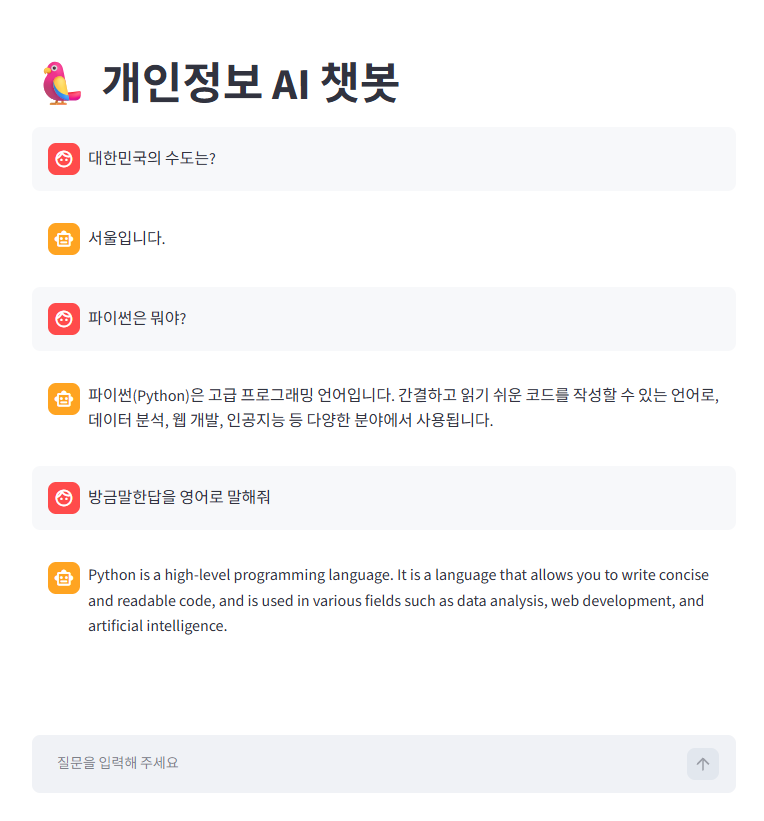

\# Personal AI Chatbot

\### Llama3 8B + PEFT(LoRA) 기반 개인 맞춤형 AI 챗봇


Python과 Streamlit을 활용하여 개발한 \*\*로컬 실행형 개인 맞춤 AI 챗봇\*\*입니다.


Llama3 8B 모델에 개인 질문·답변 데이터셋으로 PEFT(LoRA) 파인튜닝을 수행하고, 일반 상식 질문과 개인 정보 질문을 구분하여 처리하도록 구현했습니다.


외부 상용 LLM API 대신 \*\*Ollama\*\*를 이용해 개인 PC에서 모델을 실행합니다.


\## 1. 프로젝트 개요


| 항목 | 내용 |

|---|---|

| 프로젝트명 | Personal AI Chatbot |

| 개발 언어 | Python |

| 웹 인터페이스 | Streamlit |

| 기반 모델 | Llama3 8B |

| 모델 학습 | PEFT / LoRA / Unsloth |

| 데이터셋 관리 | Hugging Face Datasets |

| 모델 실행 | Ollama |

| 모델 최적화 | GGUF Q4\_K\_M 양자화 |

| 실행 환경 | Windows / Anaconda / Google Colab(학습) |


\*\*개발 목적\*\*


일반적인 지식에 답변하는 AI 챗봇을 확장하여, 사용자가 등록한 개인 정보를 이해하고 질문 의도에 따라 적절한 모델과 데이터를 활용하는 맞춤형 챗봇을 구현하는 것을 목표로 했습니다.


\## 2. 주요 기능


| 기능 | 설명 |

|---|---|

| 개인 정보 질의응답 | 등록된 프로필 및 CSV 데이터를 검색하여 답변 |

| 일반 상식 질의응답 | 기본 Llama3 모델로 일반 질문 처리 |

| PEFT 모델 활용 | 개인 정보 관련 응답 생성에 LoRA 학습 모델 사용 |

| 질문 유형 분류 | 키워드와 질문 문맥을 바탕으로 처리 경로 분리 |

| 다국어 번역 | 한국어·영어 번역 지원 |

| 대화 히스토리 | 이전 답변을 저장하고 직전 답변 번역에 활용 |

| 나이 자동 계산 | 등록된 생년월일을 기준으로 만 나이 계산 |

| 미등록 정보 처리 | 근거가 없는 개인 정보에는 미등록 안내 출력 |


## 챗봇 실행 화면

### 일반 상식 질의응답 및 문맥 기반 번역



기본 Llama3 모델을 활용한 일반 지식 응답과,
대화 히스토리에 저장된 직전 답변의 영어 번역 기능을 구현했습니다.


\## 3. 시스템 아키텍처


```text

&#x20;                 사용자 질문

&#x20;                      |

&#x20;               Streamlit UI

&#x20;                      |

&#x20;               질문 의도 분석

&#x20;                      |

&#x20;            +---------+---------+

&#x20;            |                   |

&#x20;      개인 정보 질문         일반 지식 질문

&#x20;            |                   |

&#x20;      TXT / CSV 검색        Llama3 기본 모델

&#x20;            |                   |

&#x20;      관련 정보 추출          답변 생성

&#x20;            |

&#x20;      직접 응답 또는

&#x20;      PEFT Llama3 생성

&#x20;            |

&#x20;            +---------+---------+

&#x20;                      |

&#x20;               필요시 번역 처리

&#x20;                      |

&#x20;               Streamlit 출력

```


\*\*설계 특징\*\*


\- 외부 OpenAI 및 Google Gemini API를 사용하지 않습니다.

\- 개인정보는 로컬 파일에서 불러옵니다.

\- 일반 상식 질문에는 개인정보 검색 결과가 전달되지 않도록 처리 경로를 분리했습니다.

\- 학습 모델과 기본 모델을 질문 목적에 따라 선택적으로 사용합니다.

\- 개인 정보 검색은 최종 버전에서 TXT·CSV 기반으로 구현했으며, 초기 개발 과정에서 ChromaDB 기반 검색 방식도 실험했습니다.


\## 4. AI 모델 학습 과정


\*\*① 커스텀 데이터셋 구축\*\*


개인정보 기반 질문·답변 33개를 구성하고 Hugging Face Datasets에 저장했습니다.


\*\*② 기반 모델 준비\*\*


Google Colab GPU 환경에서 Unsloth 기반 Llama3 8B 4비트 모델을 불러왔습니다.


\*\*③ PEFT(LoRA) 파인튜닝\*\*


전체 모델 가중치를 모두 재학습하는 대신 LoRA 어댑터를 활용하여 학습했습니다.


주요 학습 설정:


| 설정 | 값 |

|---|---|

| LoRA Rank | 16 |

| LoRA Alpha | 16 |

| Learning Rate | 0.0002 |

| Max Steps | 30 |

| Batch Size | 2 |

| Gradient Accumulation | 4 |


\*\*④ 모델 변환 및 배포\*\*


학습된 모델을 GGUF Q4\_K\_M 형식으로 변환하고 Ollama에 등록하여 로컬에서 추론할 수 있도록 구성했습니다.


\## 5. 기술 스택


\*\*Language \& UI\*\*

\- Python

\- Streamlit


\*\*AI \& Fine-tuning\*\*

\- Meta Llama3 8B

\- PEFT / LoRA

\- Unsloth

\- Hugging Face Datasets

\- TRL / SFTTrainer

\- PyTorch


\*\*Inference\*\*

\- Ollama

\- GGUF 양자화


\*\*Development\*\*

\- Anaconda

\- Google Colab

\- Git / GitHub


\## 6. 테스트 및 품질 개선


개발 과정에서 기능 오류를 재현하고 코드 수정 후 재시험하는 방식으로 검증했습니다.


주요 개선 사례:


\- 개인정보와 일반 상식 답변이 혼합되는 문제

\- 잘못된 개인정보 항목을 검색하는 문제

\- 프롬프트 형식이 답변에 노출되는 문제

\- 자기소개 답변 생성 오류

\- 미등록 개인정보에 대한 부정확한 응답

\- 영어·한국어 번역 처리 오류

\- 나이 계산 오류


\*\*확인된 통합 테스트 결과\*\*


| 구분 | 결과 |

|---|---|

| 최초 통합 기능 테스트 | 12건 중 9건 정상, 3건 오류 |

| 오류 수정 후 집중 재시험 | 5건 중 5건 정상 |


초기 개발 단계의 추가 테스트는 수행 이력과 결함 사례를 별도로 정리했으며, 정확한 실행 기록이 확보되지 않은 테스트는 통계에 포함하지 않았습니다.


\## 7. 프로젝트 실행 방법


\*\*사전 준비 사항\*\*


\- Python 실행 환경

\- Ollama 설치

\- 기본 Llama3 모델

\- 별도로 준비한 개인 학습 모델

\- 로컬 개인정보 파일


필요한 라이브러리:


```bash

pip install streamlit ollama

```


기본 모델 준비:


```bash

ollama pull llama3

```


개인 학습 모델은 별도 생성된 GGUF 파일과 Ollama Modelfile을 이용해 등록해야 합니다.


```bash

ollama create llama3-personal-fixed -f Modelfile

```


모델 등록 후 실행:


```bash

streamlit run chatbot.py

```


\*\*참고:\*\* 개인정보 파일 및 학습 모델 가중치는 공개 저장소에 포함하지 않습니다. 따라서 저장소의 코드만 다운로드한 상태에서는 개인 정보 기능이 즉시 실행되지 않으며, 별도 데이터와 모델 준비가 필요합니다.


\## 8. 프로젝트 파일


```text

personal-ai-chatbot/

├── chatbot.py

├── README.md

├── .gitignore

└── 기존 개발 코드

&#x20;   ├── app.py

&#x20;   ├── build\_db.py

&#x20;   └── build\_qa\_db.py

```


`chatbot.py`는 최종 챗봇 애플리케이션이며, 나머지 Python 파일은 초기 검색 기반 챗봇 개발 과정의 코드입니다.


\## 9. 개발 과정에서 배운 점


이번 프로젝트를 통해 LLM을 단순히 호출하는 것과 실제 사용 가능한 소프트웨어로 구현하는 것의 차이를 경험했습니다.


모델 파인튜닝뿐 아니라 데이터 전처리, 로컬 모델 배포, 질문 라우팅, 프롬프트 설계, 오류 재현 및 회귀 테스트가 최종 사용자 경험에 중요한 영향을 준다는 점을 확인했습니다.


특히 \*\*모델 자체의 생성 능력에만 의존하지 않고, 명확한 개인정보는 검색 결과로 처리하고 일반 질문은 별도 모델로 분리하는 방식\*\*으로 응답의 일관성을 개선했습니다.


\## 10. 보안 및 개인정보 보호


본 저장소에는 실제 개인정보 데이터셋, 인증 토큰, 학습 모델 가중치 및 개인 PC 환경 설정을 공개하지 않습니다.


개인정보를 이용한 학습과 추론은 별도로 준비한 개발 환경에서 수행했습니다.


\---


\*\*Personal AI Chatbot — Local LLM, PEFT Fine-tuning \& Software Testing Project\*\*
